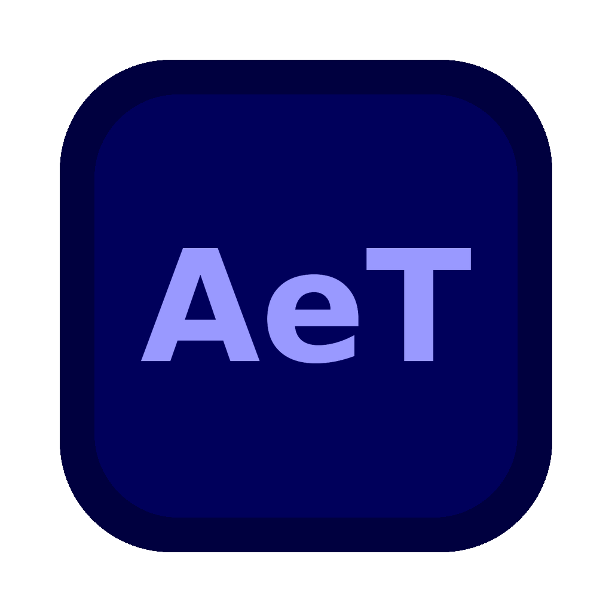

<p align="center">
  
</p>

<h1 align="center">After Effects by Tonynehihi</h1>

<p align="center">
  <b>A personal fork of <a href="https://github.com/storytold/effectcraft">EffectCraft</a> — rebranded and customized by Tony for his own use.</b><br>
  Not an official release. Personal use only.
</p>

## Origin

All of the original source code in this project is [EffectCraft](https://github.com/storytold/effectcraft) by **storytold** — a motion-graphics application written in Rust, released under the **MIT / Apache-2.0** licenses (see `LICENSE-MIT` and `LICENSE-APACHE` in this repo, kept unchanged from the original).

This repository is **not** the official EffectCraft and is not a public product release. It is a copy that Tony took, renamed to **After Effects by Tonynehihi**, and adjusted for his own personal workflow. All credit for the original software belongs to storytold and the EffectCraft contributors.

> "After Effects" is a trademark of Adobe Inc. This personal project is not affiliated with or endorsed by Adobe in any way; the name is used only for Tony's private use.

## What Tony changed

- **Name & identity**: the app is called "After Effects by Tonynehihi", with its own Adobe-style **AeT** icon (dark navy panel, periwinkle letters — the After Effects look), About screen and macOS bundle (`AeT.app`).
- **Built-in self-update**: the app checks the Releases of this repo for the newest version — once at launch (with the release's changelog on screen when something new exists) and any time from *Help → Check for Updates*. On macOS it then downloads, builds and installs the update by itself; the current version is only swapped out for a few seconds at the very end, and the previous version is kept as a backup.
- **Clean Help menu**: Check for Updates / Keyboard Shortcuts / In-App Tutorials / System Compatibility Report / About — and **no links back to the upstream project anywhere in the app** (the header Discord pill and GitHub/website buttons, the Help-menu community/docs/feedback links and the Home screen's community + sibling-apps footer are all removed).

Settings, documents and data folders keep their original EffectCraft names, so nothing already on the machine is orphaned by the rename.

## Installing on macOS

The Mac build is a source build, compiled with Cargo on Tony's own machine. In short:

```bash
cargo build --release -p deckcraft
packaging/macos/package.sh --arch aarch64
```

The DMG lands in `dist/release/`. Full instructions (clean install, removing the old build, Gatekeeper troubleshooting) are in `packaging/macos/HUONG-DAN.md` (in Vietnamese).

Once After Effects by Tonynehihi is installed, there is no need to repeat these steps for each new version: just open the app and use **Check for Updates**.

## License

Kept from the original project: **MIT OR Apache-2.0**. Tony's modifications in this repo are offered under the same terms, with the attribution above.
